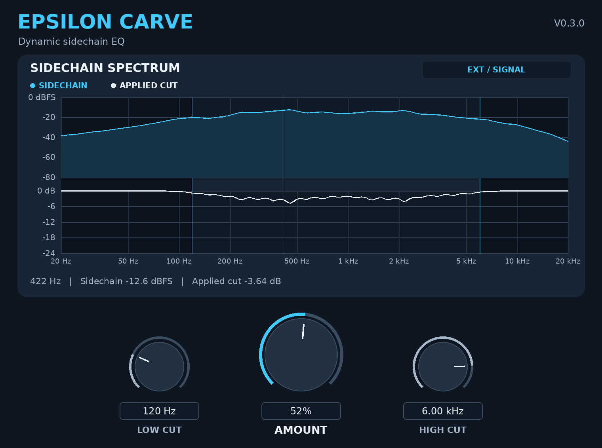

# Epsilon Carve

**Make space with three knobs. Set the low and high boundaries, then turn up Amount.**



*Editor preview drawn from the v0.3.0 engine's measured sidechain and EQ data.*

**[Download v0.3.0 source](Epsilon-Carve-v0.3.0-Source.zip)** · [v0.2.0 source](Epsilon-Carve-v0.2.0-Source.zip) · [v0.1 source](Epsilon-Carve-v0.1-Source.zip)

[Three controls](#three-controls) · [Read the display](#read-the-display) · [FL Studio setup](#fl-studio-setup) · [Build on macOS](#build-on-macos) · [Validation](#validation)

Epsilon Carve is a 32-band, sidechain-driven dynamic EQ from **Epsilon Sounds**. Put it on the track you want to make space in. The routed sidechain decides where it cuts, and the two frequency knobs limit where the cuts are applied.

**Version 0.3.0 is a source release.** Build the VST3 below to use it in FL Studio.

## Three controls

| Position | Control | What it does | Default |
| --- | --- | --- | --- |
| Left | **Low Cut** | Sets the lowest part of the spectrum that can drive ducking. Raise it to keep the bass out of vocal-triggered cuts. | 20 Hz |
| Center | **Amount** | Sets the strength of the ducking from 0% to 100%. Start at 25% and increase while listening to the target and trigger together. | 25% |
| Right | **High Cut** | Sets the upper boundary. Lower it to focus on kick and bass or to leave cymbals and synth air alone. | 20 kHz |

Both cutoffs cover 20 Hz to 20 kHz with a logarithmic knob sweep. The cutoff marks and shading update on the graph. If Low Cut reaches or passes High Cut, the active range closes and any existing cut decays.

## Read the display

- **Blue** shows the trigger's measured band levels in dBFS.
- **White** shows the total EQ cut in dB calculated from the live filter state. It includes overlapping sections and the wet/dry blend.
- **Shading** shows the range excluded by the cutoff knobs. The white curve shows the EQ's slopes at the edges.
- **Hover** over a frequency to read the sidechain level and applied cut together.

**EXT / SIGNAL** confirms a detectable external feed. **EXT / QUIET** means the bus is enabled and quiet, so the cut releases as the trigger fades. **EXT INPUT DISABLED / SELF** means the host has disabled the auxiliary input and the target is driving the detector.

## FL Studio setup

1. Put **Epsilon Carve VST3** on the Mixer insert you want to carve, such as the **beat bus**.
2. Select the **vocal** Mixer insert. Right-click the routing arrow at the bottom of the **beat bus** and choose **Sidechain to this track**. Keep the vocal's audible route to the master.
3. In the plugin wrapper, open the gear and go to **Processing → Connections**. Keep the beat as the main input and assign the **Sidechain** input to the vocal.
4. Play both tracks. Check for **EXT / SIGNAL** and movement on the blue trace. Set the cutoffs, then dial in Amount while comparing engaged and bypassed at similar loudness.

| Example | Carve on | Trigger from | Low Cut | Amount | High Cut |
| --- | --- | --- | --- | --- | --- |
| Vocal space | Beat bus | Lead vocal | 120 Hz | 25% | 6 kHz |
| Kick space | 808 insert | Kick | 30 Hz | 20% | 200 Hz |
| Low-mid overlap | Instrument bus | Vocal or lead | 300 Hz | 25% | 420 Hz |

[Image-Line Mixer routing](https://cluster.image-line.com/fl-studio-learning/fl-studio-online-manual/html/mixer.htm) · [Image-Line Plugin Wrapper](https://www.image-line.com/fl-studio-learning/fl-studio-online-manual/html/plugins/wrapper.htm)

## Build on macOS

Extract the source ZIP and open Terminal in `Epsilon-Carve-v0.3.0`. Install Xcode and CMake 3.22 or later. These commands target an Intel Mac. Skip the clone if the selected JUCE checkout is already in the `JUCE` folder beside `CMakeLists.txt`.

```bash
git clone --depth 1 --branch 8.0.17-security https://github.com/juce-framework/JUCE.git JUCE
cmake -S . -B build -G Xcode -DCMAKE_OSX_ARCHITECTURES=x86_64
cmake --build build --config Release --target EpsilonCarve_VST3
find build -type d -name 'Epsilon Carve.vst3' -print
```

Copy the entire `.vst3` bundle to `~/Library/Audio/Plug-Ins/VST3/`. In FL Studio open **Options → Manage plugins → Find installed plugins**, then load **Epsilon Carve** in a Mixer effects slot.

[JUCE CMake API](https://github.com/juce-framework/JUCE/blob/8.0.17-security/docs/CMake%20API.md) · [Image-Line plugin installation](https://www.image-line.com/fl-studio-learning-content/fl-studio-online-manual/html/basics_externalplugins.htm)

## Validation

This revision implements the Epsilon Carve research folder's starting design of 32 log-spaced detector bands driving a stable IIR EQ. The filter poles are fixed during playback. The engine smooths changes to the cut and applies one shared curve to stereo channels. Attack, Release, Sensitivity, Mix, and External Sidechain are retained as host parameters and saved state.

The cutoff IDs and stored frequencies carry over from v0.2.0. Existing normalized cutoff automation maps to different frequencies on the new logarithmic ranges.

| Offline test | Result |
| --- | --- |
| Research kit low and high scans | All 32 trigger bands resolved at both 44.1 and 48 kHz, including 20 kHz. |
| Research kit 997 Hz carrier at 48 kHz | The measured cut and displayed cut both rounded to −2.12 dB. |
| 300–420 Hz cutoff test at 80% Amount | A 362 Hz tone was cut by 8.32 dB. The 70 Hz, 1.2 kHz, and 8 kHz test tones moved by at most 0.04 dB. |
| Research kit impulse and silence probes | Amount zero and a quiet connected sidechain produced sample-exact dry output. Changing the block size and meter state produced identical samples. |

The processor and editor passed C++17 syntax checks against JUCE 8.0.17-security. Intel Mac VST3 build and FL Studio playback are pending.

[Simper's trapezoidal SVF derivation](https://cytomic.com/files/dsp/SvfLinearTrapOptimised2.pdf)
