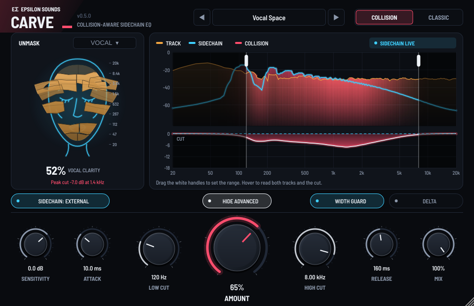
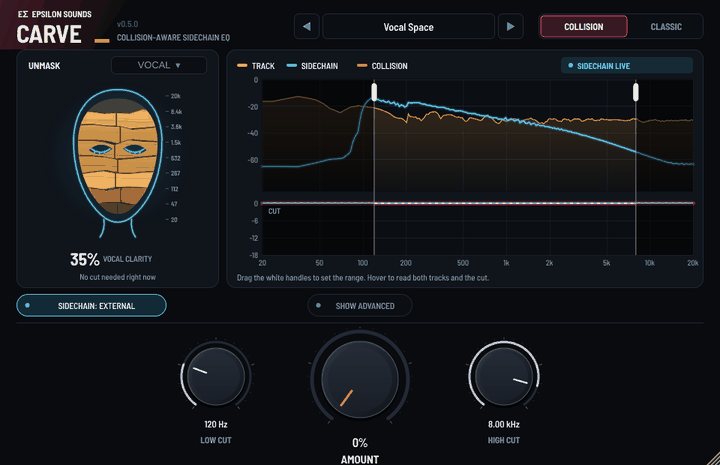

# Epsilon Carve

**Unmask what matters. Carve only where the track is in the way.**





*Both rendered by the plugin itself (Vocal Space preset, synthetic vocal over a beat).*

Epsilon Carve is a zero-latency, 32-band sidechain EQ from **Epsilon Sounds**. Put it on the beat, send it the vocal, and it carves space for the vocal in real time. **Collision mode** listens to both tracks and cuts only where the beat is loud enough to cover the vocal. The **Unmask face** shows the result: the face is whatever needs room (a vocal, a kick, a lead), the mask is the track covering it, and each shard of the mask lifts away as Carve clears that part of the spectrum.

**[Download v0.5.1 for Projucer / Xcode](Epsilon-Carve-v0.5.1-Projucer.zip)** (JUCE 9.0.5 included) · [Source only](Epsilon-Carve-v0.5.1-Source.zip) · **[Illustrated manual (PDF, 22 pages)](docs/Epsilon-Carve-v0.5.1-Manual.pdf)** · [Quick manual](docs/MANUAL.md) · [What's new](#whats-new-in-v051) · [FL Studio setup](#fl-studio-setup) · [Build](#build) · [Test results](#test-results)

## What's new in v0.5.1

| | |
| --- | --- |
| **The face is a true frequency scale** | Top to bottom = 20 kHz down to 20 Hz on a log scale, in eight equal 1.25-octave slices, with the slice edges printed beside the face. Each shard is driven only by its own slice (bands on a boundary are shared by how much of them falls in each slice), and it lifts by exactly the share of that slice's masking Carve has removed. A slice with nothing of the sidechain in it shows as a faint, still shard instead of copying its neighbours. |
| **Making room for: Vocal, Kick, Snare, 808 / Bass, Lead, Voice-over, Other** | A picker on the face sets the labels ("KICK CLARITY") and suggests the matching preset. It changes no sound, and it is saved with the session. |
| **Clarity** | "Vocal Clarity" is now "Clarity" for whatever is in the sidechain. |

## What's new in v0.5.0

| | |
| --- | --- |
| **Unmask face** | An original line-art face (the vocal) under a cracked mask (the beat). Eight shards, air at the forehead down to lows at the chin. The mask is whole when nothing is carved and lifts shard by shard as each range is cleared. **Clarity %** shows how much of the sidechain is clear of the track right now. |
| **Simple and Advanced views** | Opens with just Low Cut, Amount and High Cut. **Show Advanced** reveals Sensitivity, Attack, Release, Mix, Width Guard and Delta. The view is saved with the session. |
| **Stronger Collision mode** | Uncovers buried, quieter parts of the vocal too. At 100% it leaves about 24% of the vocal masked, vs 39% in v0.4.0 and 37% for Classic. |
| **High-resolution analyser** | 4096-point FFT with 1/6-octave smoothing for both spectra, instead of 32 points. |
| **Delta safety** | While Delta is on, the display pulses coral with a banner, the face says DELTA ON, and the Delta button stays visible even in Simple view. |
| **Look** | Embedded Barlow Semi Condensed typeface (SIL Open Font License), machined knobs with tick rings, stronger collision glow. |
| **Clearer naming** | "Self Mode" is now **Sidechain: Internal / External**. |
| **Fix** | Meters keep running if a host opens a new editor window before closing the old one. |

Parameter IDs are unchanged since v0.3.0, so saved sessions load.

## The controls

| Control | What it does | Start at |
| --- | --- | --- |
| **Amount** | How hard Carve cuts, 0–100%. Watch the mask lift. | 25–50% |
| **Low Cut / High Cut** | The range Carve may cut. Drag the white handles on the display or turn the knobs. Shards outside the range stay on, because that range is not being carved. | 120 Hz / 8 kHz for vocals |
| **Collision / Classic** | Collision cuts only where tracks overlap. Classic cuts wherever the sidechain is loud. | Collision |
| **Sidechain: External / Internal** | External uses your routed vocal. Internal lets the track carve itself. | External |
| *Advanced:* **Sensitivity** | How strongly the sidechain counts. | 0 dB |
| *Advanced:* **Attack / Release** | How fast the cut arrives and lets go. | 10 ms / 160 ms |
| *Advanced:* **Mix** | Blend of carved and original. | 100% |
| *Advanced:* **Width Guard** | Cut the centre only, keep the sides. | On for wide beats |
| *Advanced:* **Delta** | Hear only what Carve removes. Turn it off before you bounce. | Off |

Full explanations, including how the face is calculated: **[the illustrated manual](docs/Epsilon-Carve-v0.5.1-Manual.pdf)** or [docs/MANUAL.md](docs/MANUAL.md).

## FL Studio setup

1. Put **Epsilon Carve** on the Mixer insert you want to carve (for example the beat bus).
2. Select the **vocal** insert. Right-click the routing arrow under the beat bus and choose **Sidechain to this track**. Keep the vocal's normal route to the master.
3. In the plugin wrapper, open the gear menu, then **Processing → Connections**. Keep the beat on the main input and assign the vocal to **Sidechain**.
4. Play both. The badge reads **SIDECHAIN LIVE** and the face lights up. Pick a preset, then raise Amount until the mask lifts where you need it.

## Build

**Projucer (recommended):** unzip `Epsilon-Carve-v0.5.0-Projucer.zip` and double-click `Epsilon-Carve.jucer`. JUCE 9.0.5 is bundled, so Projucer opens with everything in place. Choose **Save and Open in IDE**, select **Epsilon Carve - VST3** (or **AU**) and press ⌘B. Both builds copy the plug-in into `~/Library/Audio/Plug-Ins/`. You can also open `Builds/MacOSX/Epsilon Carve.xcodeproj` directly.

**CMake:**

```bash
git clone --depth 1 --branch 9.0.5 https://github.com/juce-framework/JUCE.git JUCE   # skip if JUCE/ is present
cmake -S . -B build -G Xcode
cmake --build build --config Release --target EpsilonCarve_VST3 EpsilonCarve_AU
cmake --build build --config Release --target CarveEngineTests && (cd build && ctest -C Release)
```

A GitHub Actions workflow (`.github/workflows/build.yml`) builds a universal VST3 + AU on macOS. It runs only when started by hand or on a version tag, to save macOS minutes on a private repository.

## Test results

Run on Linux for this release. The Mac build and FL Studio listening pass are still to be done on Edison's MacBook Pro.

- **pluginval strictness 8**: passed at 44.1, 48 and 96 kHz with 64–1024-sample blocks, including editor, state restoration, parameter fuzzing and bus layouts. [Log](docs/pluginval-linux-strictness8.txt)
- **Engine tests**: 18 of 18 pass (even cut depth, Collision behaviour, Width Guard, sample-exact bypass, block-size independence, extreme levels, 22.05–192 kHz). [Results](docs/engine-test-results.txt)
- **CPU**: about 2–4% of one core at 48 kHz stereo on the build machine, a little more while the window is open. Zero latency. Full-window repaint about 7–9 ms in software rendering.
- **Collision vs Classic, synthetic vocal over a beat**: Collision at 55% matched Classic at 100% for clarity (37% vs 36.5% of the vocal still masked) while removing 18% less of the beat (−1.19 vs −1.45 dB). When the beat dropped 15 dB, it removed 69% less (−0.43 vs −1.38 dB). At 100% it cleared far more (24% masked vs 36.5%). One synthetic test, not a listening test.

## Notes

- Epsilon Carve, its face artwork and its interface are original designs. It is not affiliated with any other company's product.
- Engine: 32 log-spaced bands, 20 Hz–20 kHz, trapezoidal state-variable filters ([Simper](https://cytomic.com/files/dsp/SvfLinearTrapOptimised2.pdf)), constant-octave bandwidth up to Nyquist. Masking-aware cutting follows the idea of masking-reduction EQ (Hafezi & Reiss, [*Autonomous multitrack equalization based on masking reduction*](https://www.aes.org/e-lib/browse.cfm?elib=17637), JAES 2015).
- Font: Barlow Semi Condensed © The Barlow Project Authors, SIL Open Font License 1.1 (`Resources/Barlow-OFL.txt`).

Older versions: [v0.5.0 Projucer](Epsilon-Carve-v0.5.0-Projucer.zip) · [v0.4.0 Projucer](Epsilon-Carve-v0.4.0-Projucer.zip) · [v0.4.0 source](Epsilon-Carve-v0.4.0-Source.zip) · [v0.3.0 Projucer](Epsilon-Carve-v0.3.0-Projucer.zip) · [v0.3.0 source](Epsilon-Carve-v0.3.0-Source.zip) · [v0.2.0](Epsilon-Carve-v0.2.0-Source.zip) · [v0.1](Epsilon-Carve-v0.1-Source.zip)
