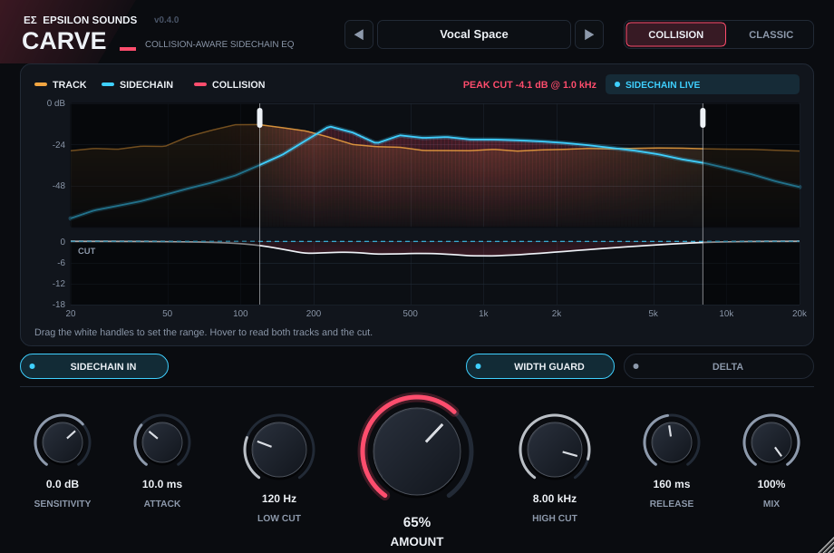

# Epsilon Carve

**Make room for the vocal. Only where the beat is actually in the way.**



*Rendered by the v0.4.0 plugin itself (Vocal Space preset, Amount 65%, synthetic vocal over a beat).*

Epsilon Carve is a zero-latency, 32-band sidechain EQ from **Epsilon Sounds**. Put it on the beat, send it the vocal, and it carves space for the vocal in real time. v0.4.0 adds **Collision mode**: Carve listens to *both* tracks and cuts only where the beat is loud enough to cover the vocal, only as deep as it needs to.

**[Download v0.4.0 for Projucer / Xcode](Epsilon-Carve-v0.4.0-Projucer.zip)** (JUCE 9.0.5 included) · [Source only](Epsilon-Carve-v0.4.0-Source.zip) · [User manual](docs/MANUAL.md) · [What's new](#whats-new-in-v040) · [FL Studio setup](#fl-studio-setup) · [Build](#build) · [Test results](#test-results)

## What's new in v0.4.0

| | |
| --- | --- |
| **Collision mode** (new default) | Measures the track and the sidechain in all 32 bands. A band is cut only when the track would mask the sidechain there, and only far enough to give the sidechain about 9 dB of clearance. Never deeper than Classic mode. |
| **Width Guard** | Carves only the centre (Mid) of the track. The stereo sides, where pads, reverbs and wide synths live, keep their width. |
| **Delta** | Hear only what Carve is removing. |
| **Even cut depth** | v0.3.0's cut varied by about 11 dB depending on where a note fell between bands, and faded above 8 kHz. Now within about 4 dB from 55 Hz to 18 kHz at 44.1, 48 and 96 kHz. |
| **Sharper detection** | 4th-order band detectors: a loud note no longer registers in bands four octaves away. |
| **New panel** | Collision display (track, sidechain and collision zones), drag-to-set range handles, all seven controls on the panel, 10 factory presets, scalable window 75–200%. |
| **Mac build fixes** | JUCE 9.0.5, macOS 12.0 target, Debug optimised to -O3 (the Xcode Build/Run default), universal Release. |

Parameter IDs from v0.3.0 are unchanged, so saved sessions load. New parameters (Mode, Width Guard, Delta) start at their defaults.

## The controls

| Control | What it does | Start at |
| --- | --- | --- |
| **Amount** | How hard Carve cuts, 0–100%. | 25–40% |
| **Low Cut / High Cut** | The frequency range Carve may cut. Drag the white handles on the display or turn the knobs. | 120 Hz / 8 kHz for vocals |
| **Sensitivity** | How strongly the sidechain counts. Raise it for quiet or distant sources. | 0 dB |
| **Attack / Release** | How fast the cut arrives and lets go. | 10 ms / 160 ms |
| **Mix** | Blend of carved and original. | 100% |
| **Collision / Classic** | Collision cuts only where tracks overlap. Classic cuts wherever the sidechain is loud. | Collision |
| **Width Guard** | Cut the centre only, keep the sides. | On for vocals over wide beats |
| **Delta** | Monitor the removed signal only. Turn it off before you bounce. | Off |
| **Sidechain In / Self Mode** | Use the routed sidechain, or let the track carve itself. | Sidechain In |

Full explanations, including what happens under the hood: **[docs/MANUAL.md](docs/MANUAL.md)**.

## FL Studio setup

1. Put **Epsilon Carve** on the Mixer insert you want to carve (for example the beat bus).
2. Select the **vocal** insert. Right-click the routing arrow under the beat bus and choose **Sidechain to this track**. Keep the vocal's normal route to the master.
3. In the plugin wrapper, open the gear menu, then **Processing → Connections**. Keep the beat on the main input and assign the vocal to **Sidechain**.
4. Play both. The badge on the display reads **SIDECHAIN LIVE** and the cyan trace moves. Pick a preset, then set Amount by ear while toggling bypass.

## Build

**Projucer (recommended):** unzip `Epsilon-Carve-v0.4.0-Projucer.zip` and double-click `Epsilon-Carve.jucer`. JUCE 9.0.5 is bundled, so Projucer opens with everything in place. Choose **Save and Open in IDE**, select **Epsilon Carve - VST3** (or **AU**) and press ⌘B. Both builds copy the plug-in into `~/Library/Audio/Plug-Ins/`. You can also open `Builds/MacOSX/Epsilon Carve.xcodeproj` directly.

**CMake:**

```bash
git clone --depth 1 --branch 9.0.5 https://github.com/juce-framework/JUCE.git JUCE   # skip if JUCE/ is present
cmake -S . -B build -G Xcode
cmake --build build --config Release --target EpsilonCarve_VST3 EpsilonCarve_AU
cmake --build build --config Release --target CarveEngineTests && (cd build && ctest -C Release)
```

On macOS, a plug-in you built yourself is not quarantined. If you copy a downloaded build from GitHub Actions instead, run `xattr -dr com.apple.quarantine "~/Library/Audio/Plug-Ins/VST3/Epsilon Carve.vst3"`.

## Test results

Run on Linux for this release (the Mac build and FL Studio listening pass are still to be done on Edison's MacBook Pro):

- **pluginval strictness 8**: passed at 44.1, 48 and 96 kHz with 64–1024-sample blocks, including state restoration, parameter fuzzing, bus layouts and editor tests. [Log](docs/pluginval-linux-strictness8.txt)
- **Engine tests**: 18 of 18 pass. Even cut depth at 44.1/48/96 kHz, Collision behaviour, Width Guard leaves the side channel untouched (0.000 dB), sample-exact output at Amount 0 and with a silent sidechain, identical output for 64- and 997-sample blocks, finite output at +34 dBFS, 22.05–192 kHz, mono and stereo. [Results](docs/engine-test-results.txt)
- **CPU**: about 2% (Classic) to 3.5% (Collision) of one core at 48 kHz stereo on the build machine. Zero latency.
- **Collision vs Classic, synthetic vocal over a beat**: for about the same unmasking, Collision removed roughly 25% less of the beat while it was busy (−1.08 dB vs −1.45 dB) and 75% less when the beat dropped by 15 dB (−0.32 dB vs −1.38 dB). This is one synthetic test, not a listening test.

## Notes

- Epsilon Carve is an original design. It is not affiliated with, and does not reproduce, any other company's product.
- Engine: 32 log-spaced bands, 20 Hz–20 kHz, trapezoidal state-variable filters ([Simper](https://cytomic.com/files/dsp/SvfLinearTrapOptimised2.pdf)), constant-octave bandwidth up to Nyquist. Masking-aware cutting follows the idea of masking-reduction EQ described in the mix-engineering literature (for example Hafezi & Reiss, *Autonomous multitrack equalization based on masking reduction*, JAES 2015).

Older versions: [v0.3.0 Projucer](Epsilon-Carve-v0.3.0-Projucer.zip) · [v0.3.0 source](Epsilon-Carve-v0.3.0-Source.zip) · [v0.2.0](Epsilon-Carve-v0.2.0-Source.zip) · [v0.1](Epsilon-Carve-v0.1-Source.zip)
