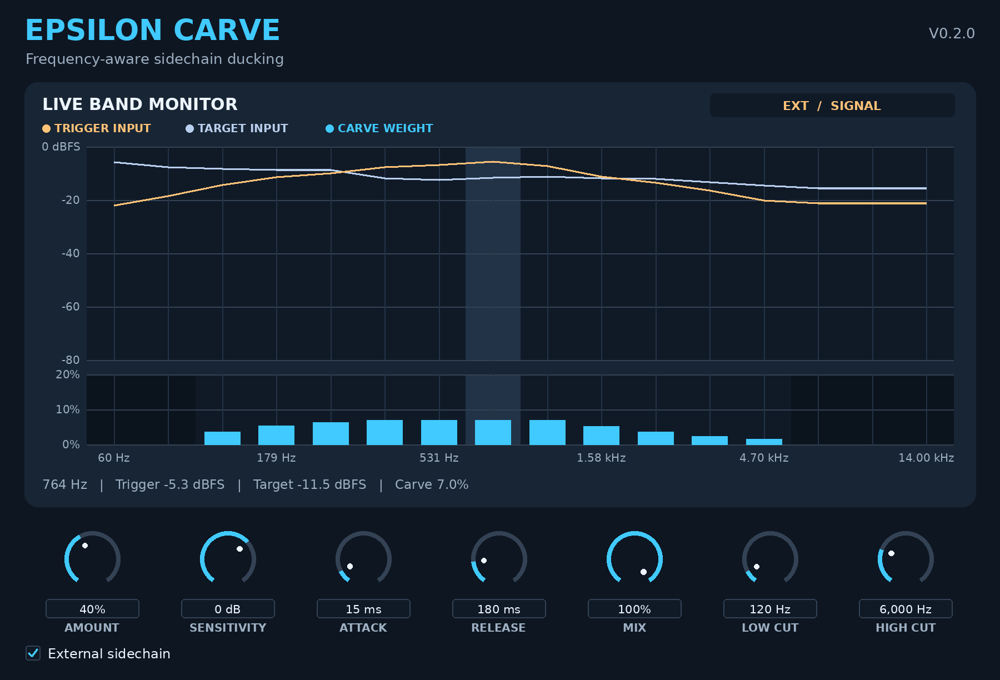

# Epsilon Carve

**Frequency-aware sidechain ducking with a live 16-band monitor.**



*Editor illustration rendered from a test-signal frame captured by the v0.2.0 DSP.*

**[Download Epsilon Carve v0.2.0 source](Epsilon-Carve-v0.2.0-Source.zip)** · [Previous v0.1 package](Epsilon-Carve-v0.1-Source.zip)

[Live band monitor](#live-band-monitor) · [Controls](#controls) · [FL Studio setup](#fl-studio-setup) · [Starting settings](#starting-settings) · [Build on macOS](#build-on-macos)

Epsilon Carve is an experimental JUCE effect from **Epsilon Sounds**. Insert it on the track you want to make space in, such as a beat bus. Send a second track, such as your vocal, to its sidechain. The detector listens across 16 frequency bands and uses that energy to reduce overlapping bands in the beat.

**Version 0.2.0 is a source release.** Build the VST3 below to open the live monitor. FL Studio validation is pending.

## Live band monitor

The two lanes share the same 16 frequency positions. Hover a position to read its frequency and all three values together.

| Display | What it shows |
| --- | --- |
| **Amber trigger trace** | Band levels of the audio feeding the detector, before Sensitivity gain. With External Sidechain active and routed, this is the vocal, kick, or other trigger. |
| **Pale blue target trace** | Band levels of the target before carving. In the vocal example, this is the beat bus. Compare it with the trigger trace to see which ranges overlap. |
| **Cyan carve bars** | The actual weight used to subtract each filtered target band, including Amount and Mix. The scale is a percentage of that band contribution. The overlapping filters make the output attenuation dependent on the signal. |

Both input traces show peak dBFS over roughly 33 ms, using the stronger channel. The bars show the strongest applied weight over the same window. Cutoff settings shade excluded bands in the lower lane. A band can still show a short decay after its cutoff changes.

**Check the routing while playing a vocal over the beat.** The badge should show **EXT / SIGNAL** while the vocal is present. Mute the vocal feed and watch the amber trace fall and the bars release while the pale trace keeps moving. **EXT / QUIET** means the external bus is enabled and effectively silent. **EXT INPUT DISABLED / SELF** means the host disabled the external bus and the target is feeding the detector. Turning External Sidechain off displays **SELF DETECTION**.

## Controls

| Control | Range and default | How to use it |
| --- | --- | --- |
| **Amount** | 0–100% · **40%** | Scales the cuts. Try 25% on a beat bus and raise it until the vocal comes through. The cyan bars settle to zero at 0%. |
| **Sensitivity** | −48 to +24 dB · **0 dB** | Sets detector gain. Raise it for a quiet sidechain. Lower it if breaths and background noise trigger too much carving. Watch the bars respond while the amber input trace stays at the original level. |
| **Attack** | 1–150 ms · **15 ms** | Sets how fast the detector rises. Shorten it for a kick hit or lengthen it to let more of the target's leading edge through. |
| **Release** | 10–1,000 ms · **180 ms** | Sets how fast the detector relaxes. Shorten it if the beat stays tucked between vocal phrases. Lengthen it if the cuts audibly pulse. |
| **Mix** | 0–100% · **100%** | Blends the dry and processed target. Lower it to reduce the applied cut weight. At 0%, the input traces stay live and the cyan bars show zero. |
| **Low Cut** | 30–1,000 Hz · **40 Hz** | Excludes cuts below the selected nominal band center. Raise it to keep more bass while carving for a vocal. |
| **High Cut** | 1,000–20,000 Hz · **16,000 Hz** | Excludes cuts above the selected nominal band center. Lower it to keep cymbal or synth air steadier. |
| **External Sidechain** | Off/On · **On** | On selects the secondary input when the host enables it. Off selects the target as the trigger. Check the badge to see which route is active. |

## FL Studio setup

1. Insert **Epsilon Carve VST3** in an effects slot on the **beat bus** Mixer insert.
2. Select the **vocal** Mixer insert. Right-click the routing arrow at the bottom of the **beat bus** insert and choose **Sidechain to this track**. Keep the vocal's audible route to the master.
3. In the plugin wrapper, open the gear and go to **Processing → Connections**. Keep the main input on the beat bus and map the secondary **Sidechain** input to the vocal. Right-click the input assignment field to select the source by name when available.
4. Turn **External Sidechain** on. Play both tracks and check the badge and amber trace. If the vocal sounds doubled, set the audible send level to zero so the route feeds only the sidechain.
5. Start with the settings below. Listen with the effect engaged and bypassed at similar playback levels. The display helps identify the reacting bands while you dial in Amount and timing.

Image-Line covers the routing and input assignment in its manuals. [Mixer routing](https://cluster.image-line.com/fl-studio-learning/fl-studio-online-manual/html/mixer.htm) · [Plugin Wrapper](https://www.image-line.com/fl-studio-learning/fl-studio-online-manual/html/plugins/wrapper.htm)

## Starting settings

Use External Sidechain **On**, Sensitivity **0 dB**, and Mix **100%** to start.

| Use | Insert Carve on | Trigger | Amount | Attack / release | Low / high cut |
| --- | --- | --- | --- | --- | --- |
| **Vocal over beat** | Beat bus | Lead vocal | 25% | 15 / 180 ms | 120 Hz / 6 kHz |
| **Kick through a rubbery 808** | 808 insert | Kick | 20% | 5 / 100 ms | 40 Hz / 1 kHz |
| **Lead over a sample** | Sample bus | Lead synth | 20% | 20 / 220 ms | 200 Hz / 5 kHz |

For the kick and 808, lengthen Attack toward 15 ms if the hit feels too sharp or the bass loses its bounce. When mixing a vocal, reduce Amount or shorten Release if the beat sounds thin between phrases.

## Build on macOS

Extract the source ZIP and open Terminal in `Epsilon-Carve-v0.2.0`. Install Xcode and CMake 3.22 or later. Use the following commands on an Intel Mac. Skip the clone command if the selected JUCE version is already in the `JUCE` folder beside `CMakeLists.txt`.

```bash
git clone --depth 1 --branch 8.0.17-security https://github.com/juce-framework/JUCE.git JUCE
cmake -S . -B build -G Xcode -DCMAKE_OSX_ARCHITECTURES=x86_64
cmake --build build --config Release --target EpsilonCarve_VST3
find build -type d -name 'Epsilon Carve.vst3' -print
```

Copy the entire `.vst3` bundle to `~/Library/Audio/Plug-Ins/VST3/`. In FL Studio open **Options → Manage plugins → Find installed plugins** and load **Epsilon Carve** in a Mixer effects slot.

[JUCE CMake API](https://github.com/juce-framework/JUCE/blob/master/docs/CMake%20API.md) · [Image-Line plugin installation](https://www.image-line.com/fl-studio-learning-content/fl-studio-online-manual/html/basics_externalplugins.htm)

## Validation and limits

The DSP tests covered separate trigger and target tones, cutoff gating, silent external input, self-detection, and meter handoff. At 44.1, 48, and 96 kHz the comparison signals matched the v0.1 processing equation sample for sample, with the monitor enabled and disabled. The JUCE processor and editor passed compiler syntax checks against JUCE 8.0.17-security. The Intel macOS VST3 build and FL Studio playback still need testing.

The monitor uses the same band filters as the DSP. It shows nominal centers from 60 Hz to 14 kHz. Actual centers are capped at 12% of the sample rate, so upper bands can share the same filter response. Hovering those bands shows both the nominal frequency and the capped center. The current monitor measures these 16 bands.
