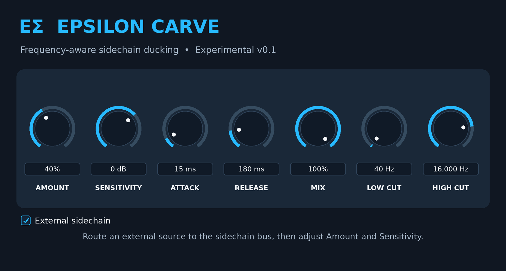

# Epsilon Carve

**Make room for a vocal, kick, or lead with frequency-aware sidechain ducking.**



*Illustration of the v0.1 editor at its factory defaults.*

**[Download Epsilon Carve v0.1 source](Epsilon-Carve-v0.1-Source.zip)** · [Controls](#controls) · [FL Studio setup](#fl-studio-setup) · [Starting settings](#starting-settings) · [Build on macOS](#build-on-macos)

Epsilon Carve is an experimental JUCE effect from **Epsilon Sounds**. Put it on the track you want to make space in, such as a beat bus. Send a second track, such as your vocal, to its sidechain. The detector listens across 16 frequency bands and uses that energy to reduce overlapping bands in the beat as the vocal plays. The vocal keeps its own route to the master.

**Version 0.1 is a source prototype.** The ZIP contains the JUCE project and its original design material. Building the VST3 requires Xcode, CMake, and JUCE. FL Studio behavior still needs a host test.

## Controls

| Control | Range and default | How to use it |
| --- | --- | --- |
| **Amount** | 0–100% · **40%** | Scales the strength of the frequency cuts. Start around 25% on a beat bus and raise it until the vocal reads clearly. At 0%, the cuts settle to zero. |
| **Sensitivity** | −48 to +24 dB · **0 dB** | Sets detector input gain. Raise it for a quiet sidechain or lower it if light breaths and background noise trigger too much ducking. It leaves the audible source level alone. |
| **Attack** | 1–150 ms · **15 ms** | Sets how fast the detector rises. Shorten it to make room for a kick hit. Lengthen it for a gentler move that lets more of the target's leading edge through. |
| **Release** | 10–1,000 ms · **180 ms** | Sets how fast the detector relaxes. Shorten it if the beat stays tucked between phrases. Lengthen it if the ducking audibly pulses. |
| **Mix** | 0–100% · **100%** | Blends dry and processed target audio. Keep it at 100% while dialing in Amount. Lower it if you want some original target signal blended back in. |
| **Low Cut** | 30–1,000 Hz · **40 Hz** | Excludes ducking bands whose center is below this setting. Raise it to keep a beat's bass fuller when carving for a vocal. |
| **High Cut** | 1,000–20,000 Hz · **16,000 Hz** | Excludes ducking bands whose center is above this setting. Lower it to keep cymbal or synth air steadier. The lowest setting is 1 kHz. |
| **External sidechain** | Off/On · **On** | On uses the host's secondary input when that bus is enabled. Off makes the target feed its own detector. If the host disables the bus, the processor also uses the target. An enabled bus carrying silence will trigger no new external ducking. |

Low Cut and High Cut select which detector bands can affect the target. Their frequency readouts refer to nominal band centers. The filters overlap, so the boundaries are gradual.

## FL Studio setup

This routing example uses a vocal as the trigger and a beat bus as the target. Use the **VST3** version after building and scanning it.

1. Insert **Epsilon Carve** in an effects slot on the **beat bus** Mixer insert.
2. Select the **vocal** Mixer insert. Right-click the routing arrow at the bottom of the **beat bus** insert and choose **Sidechain to this track**. Keep the vocal's existing audible route to the master.
3. Open Epsilon Carve. Click the wrapper's gear, then open **Processing → Connections**. Keep the main input on the beat bus and assign the plugin's secondary **Sidechain** input to the vocal. Right-click the secondary input's assignment field to pick the source by name when available.
4. Enable **External sidechain** in Epsilon Carve. Start with the **Vocal over beat** settings below. Play a phrase, then bypass the effect in the Mixer and compare at similar listening levels.
5. To check the route, temporarily silence the vocal feed while the beat plays. With the secondary bus active, the beat should return toward its dry sound over the release. If the effect follows the beat instead, check whether FL Studio enabled the secondary bus.

If the vocal appears doubled in the beat bus, recheck the Mixer send. The routing arrow should supply a sidechain-only feed with its audible send level at zero. If the secondary input is missing, verify that FL Studio loaded the VST3 and that the vocal send was created before assigning inputs.

Image-Line documents these controls in [Mixer routing](https://cluster.image-line.com/fl-studio-learning/fl-studio-online-manual/html/mixer.htm) and the [Plugin Wrapper](https://www.image-line.com/fl-studio-learning/fl-studio-online-manual/html/plugins/wrapper.htm).

## Starting settings

Use External sidechain **On**, Sensitivity **0 dB**, and Mix **100%** for these examples. Adjust Amount after confirming the trigger route.

| Use | Put Carve on | Trigger it with | Amount | Attack / release | Low / high cut |
| --- | --- | --- | --- | --- | --- |
| **Vocal over beat** | Beat bus | Lead vocal | 25% | 15 / 180 ms | 120 Hz / 6 kHz |
| **Kick through a rubbery 808** | 808 insert | Kick | 20% | 5 / 100 ms | 40 Hz / 1 kHz |
| **Lead over a sample** | Sample bus | Lead synth | 20% | 20 / 220 ms | 200 Hz / 5 kHz |

For the kick and 808 example, lengthen Attack toward 15 ms if the hit feels too sharp or the 808 loses its bounce. If you hear the beat thin out between vocal phrases, reduce Amount first or shorten Release.

## Build on macOS

1. Extract the source ZIP and open a terminal in `Epsilon-Carve-v0.1`. You need Xcode and CMake 3.22 or later. Put JUCE in the `JUCE` subfolder beside `CMakeLists.txt`.
2. In `CMakeLists.txt`, add `juce_generate_juce_header(EpsilonCarve)` immediately after `juce_add_plugin(...)`. The editor includes the generated `JuceHeader.h`.
3. In `Source/PluginProcessor.cpp`, remove the unused `const auto* side = ...` declaration in `processBlock` (the ZIP has it written as `const auto* side=...`). The active detector already reads the sidechain inside its channel check. Removing the unused read avoids asking a disabled bus for channel 0.
4. Build the Intel VST3 on an Intel Mac. Clone JUCE first if the `JUCE` folder is absent.

   ```bash
   git clone --depth 1 https://github.com/juce-framework/JUCE.git JUCE
   cmake -S . -B build -G Xcode -DCMAKE_OSX_ARCHITECTURES=x86_64
   cmake --build build --config Release --target EpsilonCarve_VST3
   find build -type d -name 'Epsilon Carve.vst3' -print
   ```

5. Copy the entire `.vst3` bundle to `~/Library/Audio/Plug-Ins/VST3/`. In FL Studio go to **Options → Manage plugins → Find installed plugins**, then look for **Epsilon Carve** in a Mixer effects slot.

See the [JUCE CMake API](https://github.com/juce-framework/JUCE/blob/master/docs/CMake%20API.md) and [Image-Line's plugin installation guide](https://www.image-line.com/fl-studio-learning-content/fl-studio-online-manual/html/basics_externalplugins.htm).

## Prototype limits

The editor contains the eight controls shown above. A spectrum analyzer, mid/side mode, and factory presets appear in the older design material and are outside the v0.1 editor. The filter code clamps actual band frequencies to 12% of sample rate, so upper-band behavior needs particular attention in listening tests at 44.1 and 48 kHz. Confirm the build, sidechain route, and playback on a test session before relying on it in a mix.
